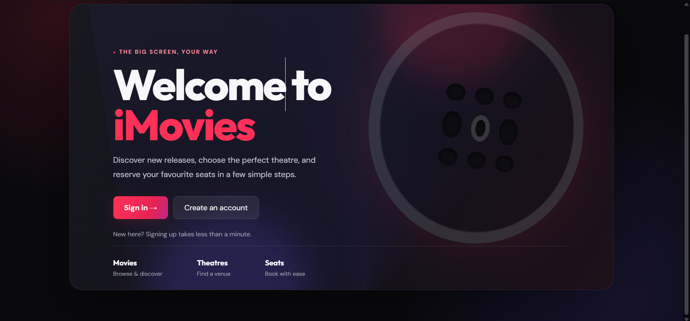
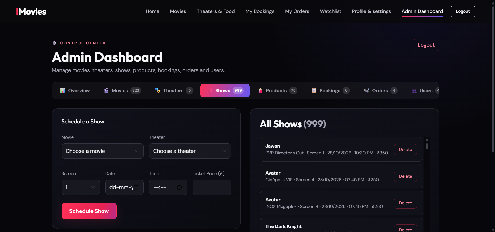
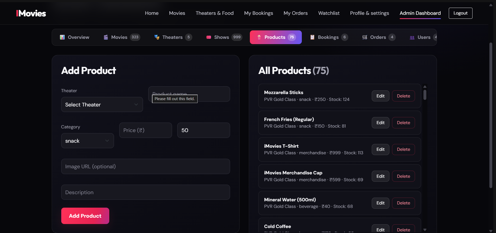

# iMovies

iMovies is a movie discovery and cinema booking application. Users can browse
films, find theaters and showtimes, reserve seats, save a watchlist, and order
theater products. Administrators can manage the movie catalog, theaters,
showtimes, products, bookings, orders, and user roles.

## Screenshots

The screenshots below are stored in [`client/assets/screenshot/`](client/assets/screenshot/).



[Watch the iMovies demo walkthrough](client/assets/demo%20link/imovies%20demo%20video.mp4)

<details>
<summary>Sign-in and registration</summary>


</details>

<details>
<summary>Admin and order-management pages</summary>







</details>

## Features

### Moviegoers

- Browse the movie catalog, filter movies, and view movie details and trailers.
- Find theaters and available showtimes.
- Select seats and view current seat availability.
- Register, sign in, and update profile settings.
- Review bookings and theater-product orders.
- Maintain a personal watchlist.
- Browse theater food and merchandise and place orders.

### Administrators

- Create, edit, and remove movies, theaters, shows, and theater products.
- Review bookings and orders.
- Update order status and manage user roles.

### Demo checkout

Payment and product checkout are demonstration flows. The booking payment
endpoint confirms a booking without charging a card or contacting a payment
provider. Theater-product orders are also automatically marked paid and
confirmed. The booking QR code is informational; it is not a bank or UPI payment
QR code.

## Technology

- **Frontend:** React, Vite, React Router, Axios, Bootstrap
- **Backend:** Node.js, Express, Mongoose
- **Database:** MongoDB
- **Authentication:** JSON Web Tokens (JWT) and bcrypt password hashing

## Project structure

```text
client/
  src/
    components/    Shared navigation, movie rows/cards, and footer
    pages/         Welcome, movie, booking, theater, account, and admin pages
    services/      API client, poster helpers, and theme utilities
  assets/
    screenshot/    Application screenshots
    demo link/     Demo walkthrough video
  public/          Client-served static assets
server/
  config/          MongoDB connection
  controllers/     API request handlers
  middleware/      Authentication and admin authorization
  models/          Mongoose schemas
  routes/          Express API routes
  seedMovies.js    Local sample data seeder
data/              Movie catalog JSON files and build script
public/            Repository-level static files
```

The frontend is a React single-page application. It calls the Express API using
Axios; the API stores users, movies, theaters, shows, bookings, seat
reservations, payments, reviews, watchlists, products, and orders in MongoDB.
Protected API requests use an `Authorization` header with the `Bearer` scheme.
Admin operations require a user whose role is `admin`.

## Application pages

| Page | Route | Access |
| --- | --- | --- |
| Welcome | `/` | Public |
| Home | `/home` | Public |
| Movies | `/movies` | Public |
| Movie details | `/movies/:id` | Public |
| Movie showtimes | `/movies/:id/shows` | Public |
| Theaters | `/theaters` | Public |
| Theater products | `/theaters/:theaterId/products` | Public |
| Sign in / register | `/login`, `/register` | Public |
| Seat selection | `/shows/:showId/seats` | Signed in |
| Bookings | `/bookings` | Signed in |
| Orders | `/orders` | Signed in |
| Watchlist | `/watchlist` | Signed in |
| Profile settings | `/profile` | Signed in |
| Admin dashboard | `/admin` | Admin |

## Requirements

- Node.js and npm
- MongoDB running locally or reachable through a MongoDB connection URI

Install dependencies separately in `server/` and `client/`; the root
`package.json` provides convenience scripts and does not install either app's
dependencies.

## Local development

### 1. Configure the API

Create `server/.env`:

```dotenv
MONGODB_URI=mongodb://127.0.0.1:27017/imovies
JWT_SECRET=replace-with-a-long-random-secret
PORT=5000
CORS_ORIGIN=http://localhost:5173
```

`MONGODB_URI` and `JWT_SECRET` are required for database access and
authentication. `PORT` defaults to `5000`. `CORS_ORIGIN` can contain a
comma-separated list of allowed origins; in development, localhost ports 5173
and 5174 are also allowed. Use a private, randomly generated JWT secret and
never commit `.env` files.

### 2. Install and start the API

In a terminal:

```powershell
cd server
npm install
npm run dev
```

The API connects to MongoDB and listens on `http://localhost:5000` by default.
Check that it is responding at:

- API information: `http://localhost:5000/`
- Health check: `http://localhost:5000/api/health`

### 3. Configure and start the frontend

In another terminal:

```powershell
cd client
npm install
```

Create `client/.env` so the Vite app calls the API on its default port:

```dotenv
VITE_API_BASE_URL=http://localhost:5000/api
```

Then start the frontend:

```powershell
npm run dev
```

Open the URL printed by Vite (normally `http://localhost:5173`). The frontend
API client defaults to `http://localhost:8000/api`, whereas the backend
defaults to port `5000`; set `VITE_API_BASE_URL` as shown above, or configure
the backend to use port `8000`.

## Sample data and local admin

With the backend environment configured and MongoDB running, seed sample
movies, theaters, products, showtimes, and a development admin account:

```powershell
cd server
npm run seed
```

The seeder adds missing catalog entries and creates upcoming shows for movies
that do not already have showtimes. Its sample catalog includes generated
placeholder listings; replace or verify those entries before using the data
in a production catalog.

Outside production, the seeder creates a local admin account if one does not
already exist. Defaults are `admin@imovies.local` and `Admin@123`; override
them with `DEMO_ADMIN_EMAIL` and `DEMO_ADMIN_PASSWORD` in `server/.env` before
seeding. These defaults are for local development only. Do not deploy them or
use them in a production environment.

## API reference

All routes below are relative to `/api`. Routes marked **User** require a valid
JWT; routes marked **Admin** require a valid JWT and an admin role.

| Method | Route | Access | Purpose |
| --- | --- | --- | --- |
| `GET` | `/health` | Public | API health check |
| `POST` | `/auth/register` | Public | Register an account |
| `POST` | `/auth/login` | Public | Sign in |
| `GET`, `PATCH` | `/auth/me` | User | Read or update the current account |
| `GET` | `/movies`, `/movies/:id` | Public | List movies or read a movie |
| `POST`, `PUT`, `DELETE` | `/movies`, `/movies/:id` | Admin | Manage movies |
| `GET` | `/theaters`, `/theaters/:id` | Public | List theaters or read a theater |
| `POST`, `PUT`, `DELETE` | `/theaters`, `/theaters/:id` | Admin | Manage theaters |
| `GET` | `/shows`, `/shows/:id` | Public | List shows or read a show |
| `POST`, `DELETE` | `/shows`, `/shows/:id` | Admin | Manage shows |
| `GET` | `/bookings/my` | User | List the current user's bookings |
| `GET` | `/bookings/show/:showId/seats` | User | Read seat availability |
| `POST` | `/bookings` | User | Create a booking |
| `PATCH` | `/bookings/:id/cancel` | User | Cancel a booking |
| `GET` | `/bookings/all` | Admin | List all bookings |
| `POST` | `/payments/demo/:bookingId` | User | Confirm a demo booking payment |
| `GET` | `/reviews/movie/:movieId` | Public | List movie reviews |
| `POST`, `DELETE` | `/reviews`, `/reviews/:reviewId` | User | Create or remove the current user's review |
| `GET`, `POST` | `/watchlist` | User | Read or add to the current user's watchlist |
| `DELETE` | `/watchlist/:movieId` | User | Remove a movie from the watchlist |
| `GET` | `/theater-products/theater/:theaterId`, `/theater-products/:id` | Public | Browse theater products |
| `GET`, `POST`, `PUT`, `DELETE` | `/theater-products` and `/theater-products/:id` | Admin | Manage products |
| `GET`, `POST` | `/orders/my`, `/orders` | User | Read the user's orders or place an order |
| `PATCH` | `/orders/:id/cancel` | User | Cancel an order |
| `GET` | `/orders` | Admin | List all orders |
| `PATCH` | `/orders/:id/status` | Admin | Update an order's status |
| `GET`, `PATCH`, `DELETE` | `/users` and `/users/:id` | Admin | Manage user records and roles |

The API root (`http://localhost:5000/`) returns a welcome message and a list
of API route groups.

## Useful commands

Run commands from the indicated directory:

| Directory | Command | Purpose |
| --- | --- | --- |
| `client/` | `npm run dev` | Start the Vite development server |
| `client/` | `npm run build` | Create the production frontend build |
| `client/` | `npm run lint` | Run ESLint |
| `client/` | `npm run preview` | Preview the production frontend build |
| `server/` | `npm run dev` | Start the API with automatic restarts |
| `server/` | `npm start` | Start the API |
| `server/` | `npm run seed` | Seed local sample data |
| `server/` | `node testDB.js` | Run the MongoDB connectivity/write check |
| repository root | `npm run dev:client` | Start the frontend |
| repository root | `npm run dev:server` | Start the API |
| repository root | `npm start` | Start the API |

The MongoDB check temporarily creates and removes a test movie, so run it only
against a database where that test write is acceptable. The server package
does not currently define an `npm test` script.
